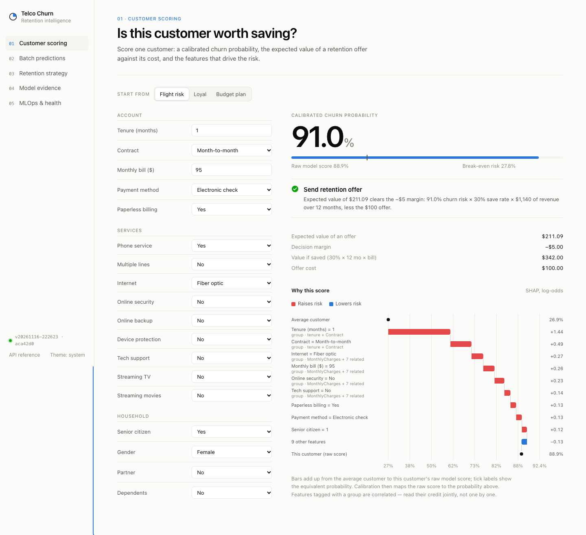
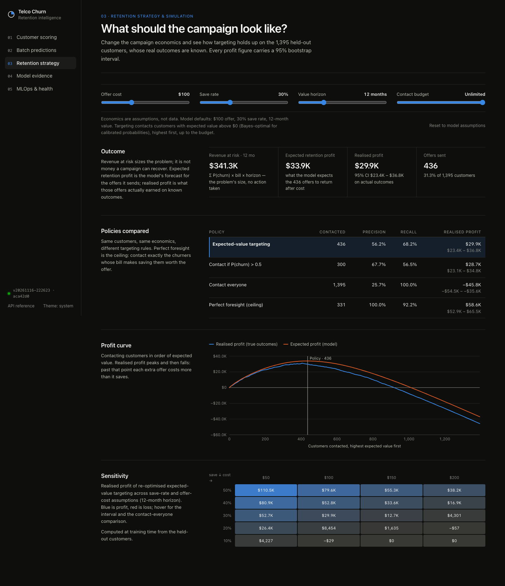

# Telco Churn: Who Is Worth Saving?

Most churn projects stop at "will this customer leave?" This one answers the question a retention team actually has:
**which customers are worth a paid offer, how sure are we, and why are they at risk?** Headline results carry 95%
confidence intervals, and every number is reproducible from this repository.

**Live app:** [telco-churn-retention.onrender.com](https://telco-churn-retention.onrender.com) · **API docs:** [/docs](https://telco-churn-retention.onrender.com/docs).
It runs on Render's free tier, which sleeps when idle, so the first request can take up to a minute.

> **The data is fictional.** IBM Telco Customer Churn describes a [fictional telco company](https://community.ibm.com/community/user/businessanalytics/blogs/steven-macko/2019/07/11/telco-customer-churn-1113)
> that IBM created for teaching. Every result here describes that sample, not a real operator.

- **Model:** XGBoost tuned with Optuna, selected against logistic regression on cross-validated log loss, then probability-calibrated.
- **Decision:** expected-value targeting with a cost-sensitive threshold.
- **Explanations:** exact SHAP values, with correlated features grouped.
- **Delivery:** a FastAPI service with a five-section web app, a git-tracked model registry with promotion gates and rollback, and CI/CD that deploys only the exact artifact it tested.



## Results

Held-out test set: 1,395 customers, touched once. Intervals come from a 2,000-resample paired bootstrap.

| | Value [95% CI] |
|---|---|
| ROC-AUC | 0.864 [0.843, 0.884] |
| Log loss · Brier | 0.391 · 0.126 |
| Calibration error (ECE) | 0.019 |
| Campaign profit, expected-value targeting | **$29,859** [$23,504, $36,385] |
| Campaign profit, contacting everyone | −$45,759 [−$54,218, −$36,606] |
| Campaign profit, perfect foresight (ceiling) | $58,563 |
| Precision · recall of the offers sent | 56.2% · 68.2% (436 contacted) |
| Revenue at risk over 12 months, no action | $341K (test) · $1.72M extrapolated to all 7,043 customers |

**What the statistics do *not* support, stated plainly:**
- **Tuned XGBoost vs tuned logistic regression:** XGBoost wins model selection (CV log loss 0.420 vs 0.428). On test, though, the paired difference is ROC-AUC +0.003 [−0.004, +0.010] and profit −$258 [−$1,950, +$1,451]. The two cannot be told apart, so the signal in this dataset is close to linear.
- **Expected-value targeting vs a plain "P(churn) > 0.5" rule:** +$1,208 [−$2,487, +$4,930]. Not significant on 1,395 customers. EV targeting's advantage is that it stays correct when the economics change; the 0.5 cutoff does not.
- **Low save rates:** if offers save only 10% of churners, targeting breaks even (−$29 [−$269, +$128]). Contacting everyone loses $108K.

Revenue at risk measures how big the problem is. Retention profit measures what a campaign earns, which depends on assumed economics: a $100 offer, a 30% save rate and a 12-month value horizon. They are different numbers. See the [model card](docs/model_card.md) and the [resume verification matrix](docs/resume_verification.md).

## Methodology

Every customer is assigned to one split by a hash of their ID. Each stage sees only its own customers, and the assignment never changes as data grows.

| Stage | Customers | What is decided there |
|---|---|---|
| Model selection | train (60%) | Optuna TPE (100 XGBoost trials with median pruning; 33 logistic). Selection uses 5-fold CV **log loss**, because the decision multiplies by the probability. |
| Calibration | calibration (20%) | Identity, Platt or isotonic, chosen by CV log loss (Platt won) |
| Decision threshold | calibration (20%) | Expected-value margin searched on *cross-fitted* calibrated probabilities. It moves off the Bayes-optimal $0 only if the gain's paired-bootstrap lower bound is above zero. It wasn't, so the policy is: contact when EV > $0. |
| Final evaluation | test (20%) | Nothing in training. Each run measures it once. Promotion gates also read it, so successive challengers reuse the same customers. This is disclosed rather than hidden: with 1,395 customers, a separate gate split would cost more precision than it buys. |

The evaluation also covers:
- **Subgroups:** discrimination and calibration per contract, tenure band, payment method, demographics and more. Every segment with n ≥ 150 is calibrated within 5.1 points.
- **Errors:** wasted offers, missed churners worth saving, and the costliest segments.
- **Correlated features:** `TotalCharges` is dropped because it is ≈ tenure × monthly bill (r = 0.9996), and the measured cost is reported. The remaining features are clustered by association (Spearman, Cramér's V, correlation ratio), so SHAP credit is read per group: *tenure + contract* and *monthly bill + internet service + 6 add-ons*.

## MLOps

```
data/** change ─▶ model.yml: train ─▶ gate vs champion ─▶ PR ─▶ merge ─▶ ci.yml: lint · verify · test · container smoke ─▶ Render (checksPass)
```

- **Registry in git.** `models/registry.json` names the champion and keeps an append-only event log. Each version stores its artifact, SHA-256 and full evaluation report. The API refuses to start if the artifact's hash doesn't match, so the deployed bytes are the tested bytes.
- **Promotion gate.** The challenger must pass:
  - floors: ROC-AUC ≥ 0.80, ECE ≤ 0.05, profitable and better than contacting everyone, every sizeable segment calibrated within 10 points;
  - paired non-inferiority against the champion on the same customers, for log loss and for profit.
- **Rollback.** Run `python -m churn.registry rollback`, or dispatch the `model` workflow with `rollback`. It steps back through previous champions and verifies each artifact.
- **Retraining** runs when the data changes, not on a timer. The registry records three real versions:
  - v1 → v2: retraining the unchanged snapshot reproduced the identical artifact, byte for byte (same SHA-256).
  - v2 → v3: the threshold rule was changed after an independent audit showed the tuned margin was fitting noise. v3 beat v2 head-to-head on profit by +$1,004 [+$144, +$1,900] with identical log loss, and was promoted through the gate.
- **Model PRs** are opened by `model.yml`. Add a `MODEL_PR_TOKEN` secret (a fine-grained PAT with contents and pull-request access) so CI runs on them, and allow Actions to create pull requests in the repository settings.
- **Drift.** `POST /drift` computes PSI plus a KS or χ² test per feature and on the score, for any batch. The app runs it on uploaded batches. A **simulation**, clearly labelled as one because the dataset is a static snapshot, shows the monitor reacting to five synthetic shifts: price rise, acquisition surge, fibre migration, contract lapse, and a no-shift control.
- **MLflow** tracks every run, every Optuna trial as a nested run, and every report and artifact.

Details are in [docs/architecture.md](docs/architecture.md).

## The app

`uvicorn churn.api:app` serves the API and a web app with five sections:

1. **Customer scoring:** a calibrated probability, the expected-value decision and a SHAP waterfall.
2. **Batch predictions:** CSV upload, a sortable decisions table, CSV export and a drift check.
3. **Retention strategy:** live economics sliders, four policies with bootstrap CIs, the profit curve and a sensitivity heatmap.
4. **Model evidence:** selection, test metrics with CIs, reliability, threshold, subgroups, errors, SHAP and feature associations.
5. **MLOps & health:** model version and hash, gate, registry timeline, live p50/p95/p99, benchmark, and the drift simulation.



## Serving performance

Measured over real HTTP; each request returns scores, decisions and SHAP reasons. Full tables are in [docs/benchmarks.md](docs/benchmarks.md).

| Workload (Apple M4 Pro) | Predictions/s | p50 | p99 |
|---|---|---|---|
| 1 customer per request, 1 client, 1 worker | 154 | 6.4 ms | 7.5 ms |
| 1 customer per request, 8 clients, 4 workers | 351 | 8.7 ms | 65.3 ms |
| 100 customers per request, 4 clients, 1 worker | 11,063 | 35.4 ms | 65.8 ms |
| 1,000 customers per request, 2 clients, 4 workers | 38,702 | 49.5 ms | 85.3 ms |

Single-worker results repeat within a few percent between runs. Multi-worker results vary more: 10 customers per request on 4 workers measured 2,354/s and 4,359/s in two runs.

## Run it

```bash
python3.14 -m venv .venv && .venv/bin/pip install -r requirements-dev.txt
.venv/bin/python -m pytest -q                         # 37 tests: API, model protocol, registry, gate, rollback
.venv/bin/uvicorn churn.api:app --port 8000           # app at http://localhost:8000, API docs at /docs
.venv/bin/python -m churn.train --promote             # retrain (~2 min): select, calibrate, evaluate, gate, register
.venv/bin/python -m churn.registry status|verify|rollback
.venv/bin/python scripts/bench.py                     # benchmark (nothing else running)
.venv/bin/mlflow ui --backend-store-uri sqlite:///mlflow.db
docker build -t telco-churn . && docker run -p 8000:8000 telco-churn
```

## Limitations

- **Fictional data.** IBM's teaching sample, not a real operator's customers.
- **Single static snapshot.** Temporal validation is impossible, and the drift section is a simulation, not an observation.
- **Assumed economics.** The campaign economics are assumptions; the sensitivity grid shows how much the conclusions depend on them.
- **Churn, not uplift.** The model predicts churn, not whether an offer *changes* behaviour. The right next step is an uplift model trained on A/B data from a real campaign.
- **SHAP is not causal.** It explains the model, not the customer.
- **Bit-for-bit retraining only on the same platform.** Retraining on Linux CI picked different Optuna hyperparameters than on macOS (floating-point differences steer the search). The result was statistically identical (ROC-AUC difference +0.0002 [−0.0008, +0.0012]), and the gate judged it so. This is why the deployed artifact is the committed, tested file, never a rebuild.
- **Free hosting.** The demo sleeps when idle, so the first request after a pause is slow; the benchmark figures come from a local machine, not from Render.

Data: [IBM Telco Customer Churn](https://github.com/IBM/telco-customer-churn-on-icp4d), 7,043 customers of a fictional company.
