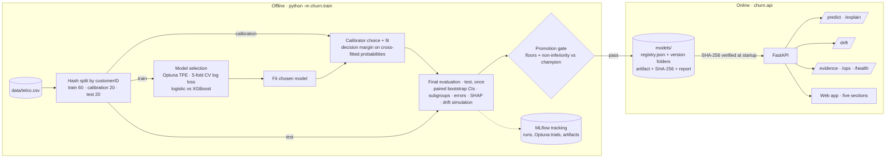
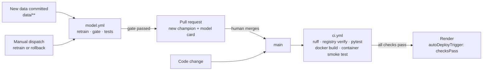

# Architecture

TelcoChurn has two halves: an **offline training pipeline**, which produces a versioned, evaluated model, and an
**online service**, which serves exactly that model. The only thing they share is the git-tracked registry in
`models/`.

## System

## Delivery

## Design decisions

| Decision | Why | Rejected alternative |
|---|---|---|
| Split by a hash of `customerID` | Assignment never changes as data grows, so a challenger is never scored on customers the champion trained on, and each stage sees only its own customers. | A random split, which reshuffles every retrain and leaks between champion and challenger. |
| Select on CV log loss, not AUC | The decision multiplies by the probability, so probability quality is what earns money. | AUC, which ignores calibration. |
| Separate calibration split; threshold tuned on cross-fitted probabilities | The calibrator and the threshold never see the customers they are judged on, and the test set is never used to choose anything. | Calibrating and thresholding on the test set, which inflates every reported number. |
| Drop `TotalCharges` | ≈ tenure × MonthlyCharges (r = 0.9996). Removing it makes duplicated SHAP credit and inconsistent API inputs impossible, at a measured cost of +0.0013 CV log loss. | Keeping it and explaining around it. |
| Group correlated features for explanations | SHAP splits credit among correlated features arbitrarily; group-level credit is stable. | Per-feature credit only. |
| Registry in git, verified by SHA-256 | CI tests the exact bytes that serve. Rollback is a pointer move with a full audit trail, and no hosted registry is needed. | A hosted MLflow registry (a paid or self-run server) or retraining inside the Docker build (which ships an untested model). |
| Retrain on data change, not on a schedule | Retraining on an unchanged, pinned snapshot reproduces the same model. A data commit is the signal that something changed. | A weekly cron. |
| Promotion by pull request | Merging is the human approval; the PR carries the gate results and the regenerated model card. | Automatic promotion straight to production. |
| Render `checksPass` | A commit deploys only after CI passes; there is no deploy script or secret to maintain. | Deploy hooks or an image registry, which add parts for the same guarantee. |
| One static web app served by the API | One container, one origin, no frontend build chain. | A separate SPA service. |

## Code map

| Module | Responsibility |
|---|---|
| `churn/data.py` | Schema, loading, fingerprint, hash split |
| `churn/economics.py` | Offer economics, expected value, revenue at risk, threshold search |
| `churn/models.py` | Candidate pipelines, Optuna, calibrators, the deployable `ChurnModel` |
| `churn/evaluation.py` | Paired bootstrap, ECE, reliability, profit curve, subgroups, error analysis, sensitivity |
| `churn/explain.py` | Feature association, correlated groups, global and per-customer SHAP |
| `churn/drift.py` | Reference profile, PSI/KS/χ², drift simulation |
| `churn/registry.py` | Versions, gate, promote, rollback, integrity check |
| `churn/train.py` | The pipeline, end to end |
| `churn/card.py` | Generates `docs/model_card.md` from the champion's report |
| `churn/api.py` | FastAPI service and web app host |
| `scripts/bench.py` | HTTP benchmark; generates `docs/benchmarks.md` |
